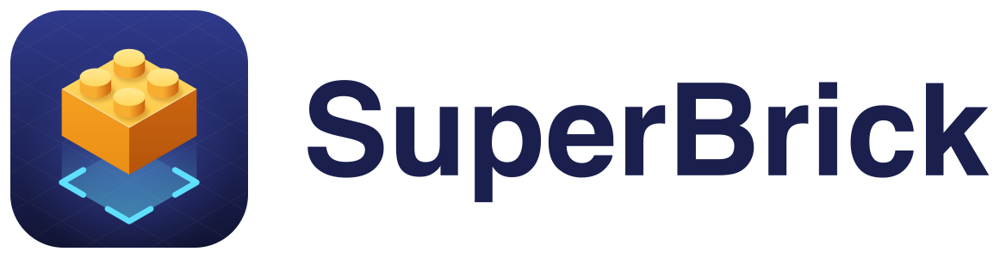
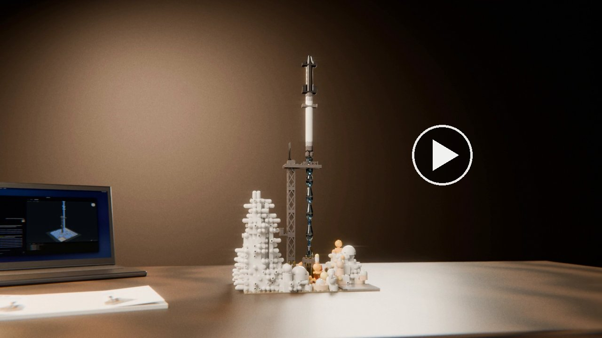

  <picture>
    <source media="(prefers-color-scheme: dark)" srcset="app/assets/wordmark.png">
    
  </picture>

<b>LEGO CAD your agent can drive.</b>

<!-- demo-video -->

  

<!-- /demo-video -->

  <a href="https://github.com/levtechs/SuperBrick/releases/latest"><b>Download SuperBrick for Mac</b></a>
  &nbsp;·&nbsp; Apple silicon, macOS 12 or later
   
  <a href="https://github.com/levtechs/SuperBrick/releases/latest"><b>Download SuperBrick for Windows</b></a>
  &nbsp;·&nbsp; Windows 10 (1803+) / 11, x64

SuperBrick is a desktop LEGO CAD app for LDraw models. You and an AI agent build in the same
project. The agent's changes come to you as drafts, and you accept or reject each one.

- **[Features and controls](docs/FEATURES.md):** a tour of the app, with screenshots.
- **[opencode plugin](https://github.com/levtechs/opencode-superbrick):** a live SuperBrick view
  beside an opencode chat.
- **[Setting up locally](docs/SETUP.md):** building from source, paths, and the agent command
  line and MCP server.

**First launch:** SuperBrick isn't registered with Apple, so macOS won't open it the first time.
Click **Done**, then go to **System Settings → Privacy & Security** and click **Open Anyway**.
On first launch the app also downloads the LDraw parts library (about 150 MB).

**First launch on Windows:** unzip `SuperBrick-<version>-Windows-x64.zip`, then run `install.ps1`
(right-click → **Run with PowerShell**), or run `SuperBrick\bin\SuperBrick.exe` directly. If
SmartScreen says "Windows protected your PC", click **More info → Run anyway**; SuperBrick isn't
code-signed. On first launch the app downloads the LDraw parts library (about 150 MB). Windows
support is new; see [the notes in SETUP.md](docs/SETUP.md#windows-support-is-new).

> Experimental. Connector checks are partial, so don't rely on SuperBrick to certify that a
> build is legal.
