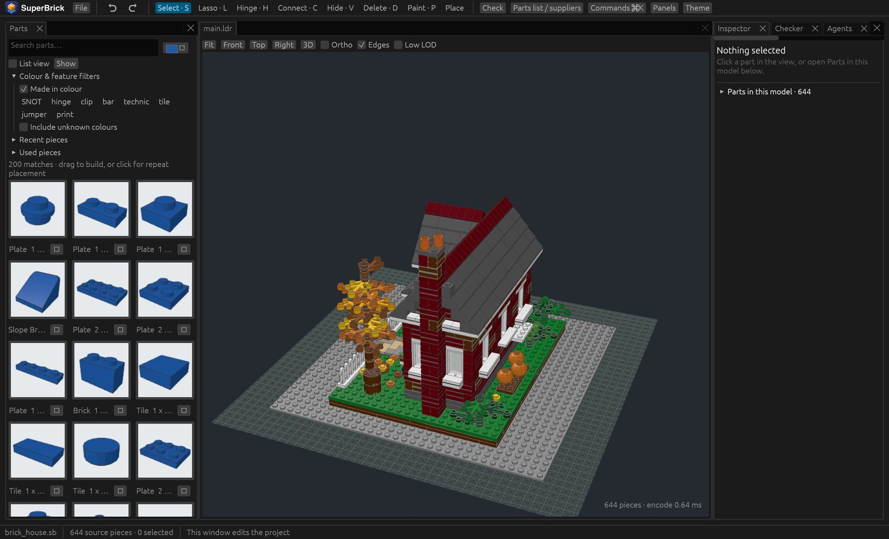
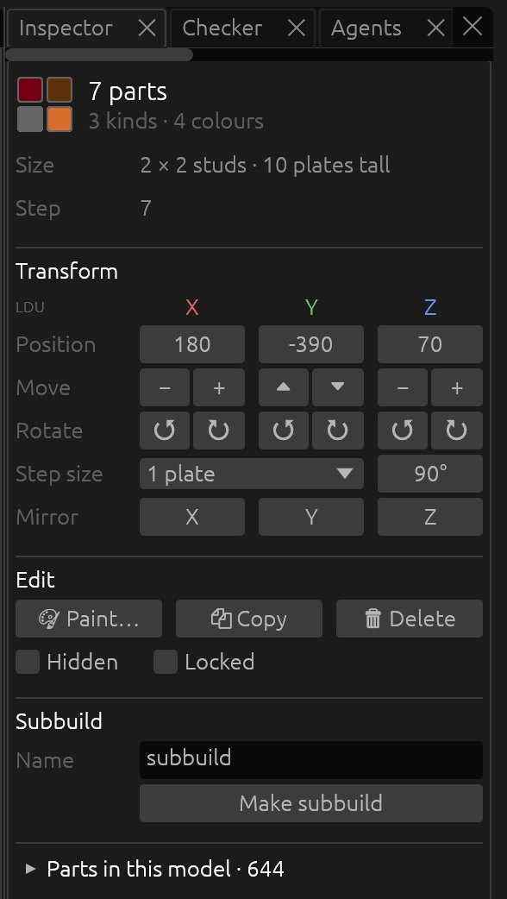
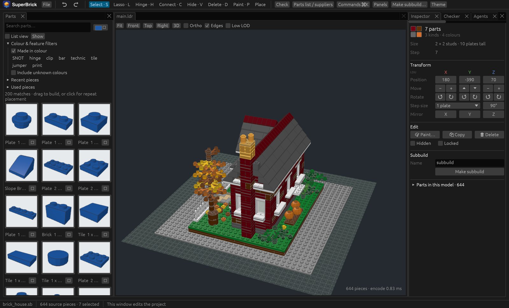
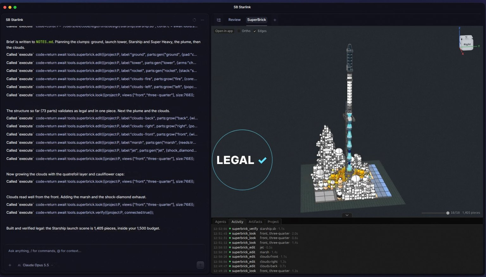
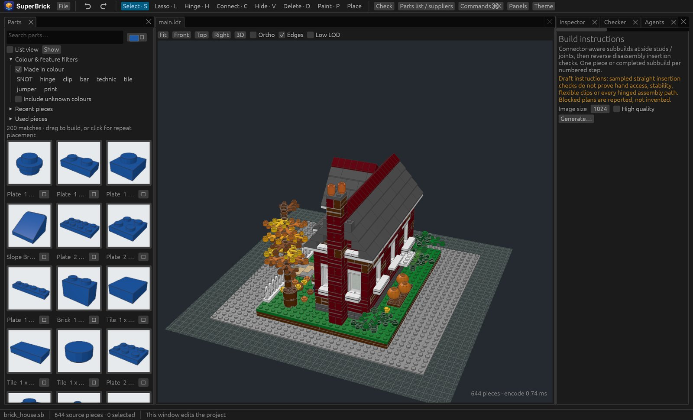

# SuperBrick features and controls

SuperBrick is a desktop LEGO CAD app (LDraw models) built so that you and an AI agent can work
on the same model. This page is the tour; [SETUP.md](SETUP.md) covers building from source and
the agent command line.

- [The window](#the-window)
- [Building](#building)
- [Selecting and the inspector](#selecting-and-the-inspector)
- [Mirror, copy and subbuilds](#mirror-copy-and-subbuilds)
- [Connectors, hinges and ball joints](#connectors-hinges-and-ball-joints)
- [Checking a build](#checking-a-build)
- [Working with an agent](#working-with-an-agent)
- [Instructions and studio renders](#instructions-and-studio-renders)
- [Parts list and buying the pieces](#parts-list-and-buying-the-pieces)
- [Projects, history and files](#projects-history-and-files)
- [Keyboard and mouse](#keyboard-and-mouse)

## The window

| Area | What it's for |
|---|---|
| **Toolbar** | Tools (Select, Lasso, Hinge, Connect, Hide, Delete, Paint, Place), **Check**, **Parts list / suppliers**, **Commands ⌘K**, **Panels** and **Theme** (light, dark, system). |
| **Parts** (left) | Search the LDraw library by words or part number, pick a colour, and drag a piece into the model. |
| **View** (middle) | The model, one tab per file or subbuild. Fit, Front, Top, Right and 3D cameras; Ortho, Edges and Low LOD switches. |
| **Inspector, Checker, Agents** (right) | The selection, build problems, and the agents' pending drafts. |

Every panel docks, closes, and reopens from **Panels**.

## Building

- **Find a piece.** Type what it looks like ("curved slope 2x1", "round plate 1x1") or an
  exact part number. Results are filtered to colours the piece was really made in; untick
  **Made in colour** to see everything. Feature chips (SNOT, hinge, clip, bar, technic, tile,
  jumper, print) narrow the search, and each result's **▾ → Show similar** finds relatives.
- **Place it.** Drag a piece into the view; it snaps to legal stud seats and won't go through
  other pieces. Click a result instead to keep placing copies of it.
- **Colours.** The swatch beside the search box picks the colour. The colour picker sorts by
  LEGO colour number or by how many pieces come in each colour. Painting a piece in a colour it
  was never made in is allowed but flagged by Check.
- **Hidden pieces.** **Hide (V)** hides pieces so you can reach inside. If a placement is
  blocked by a hidden piece, that piece flashes so you know what's in the way. **Show all** in
  the Hide options brings everything back.

## Selecting and the inspector

Click to select, Shift/Cmd-click to add, or use **Lasso (L)**. The inspector describes the
selection (pieces, kinds, colours, size in studs and plates, build step) and edits it:

- **Transform**: type a position, nudge one plate or stud at a time, rotate in 90° steps, or
  mirror in X, Y or Z.
- **Edit**: paint, copy, delete, hide and lock.
- **Subbuild**: turn the selection into a named subbuild.
- **Parts in this model**: every piece in the model, clickable.

 

## Mirror, copy and subbuilds

- **Copy (Cmd+C)** picks up the selection, pieces, colours and all, and lets you place it
  again and again; **Cmd+V** brings back the last copy, **Esc** stops.
- **Mirror** makes the left-hand version of a right-hand assembly. Each piece is checked
  against the real LDraw geometry: symmetric pieces are turned, handed pieces are swapped for
  their counterparts (for example 41769 ↔ 41770). If a piece has no mirror image, nothing
  changes and the offending piece is X-rayed in the view.
- **Subbuilds** are separate files inside the project (an arm, a leg, a base) that appear as
  one piece in the main model and can be placed many times. Each has its own view tab.

## Connectors, hinges and ball joints

- **Connect (C)** shows a piece's connectors as dots (studs, pins, axles, clips, bars, ball
  joints). Click one connector, then its partner, and the piece moves to mate them.
- **Hinge (H)** turns a hinged, turntable or ball-jointed part of the model about its joint.

## Checking a build

**Check** looks for overlapping pieces, pieces or groups that aren't attached to anything,
and colours LEGO doesn't make for that piece. Each problem lists its pieces with a button to
select them; the culprit is X-rayed in the view.

## Working with an agent

Agents (Claude Code, opencode and other MCP clients) open the same project file through
SuperBrick's MCP server. They search for parts, find legal spots, build, look at rendered
pictures of what they did and check the result, just like you.

Nothing an agent does changes your model until you say so. Its edits arrive as **drafts** in the
**Agents** tab, grouped by agent, shown as ghosts in the view. Accept or reject each one; a
reject note is passed back to the agent. If you change a piece a draft depends on, the draft is
marked stale and can't be accepted until the agent redoes it.

For a full chat-plus-viewer setup, the [opencode SuperBrick plugin](https://github.com/levtechs/opencode-superbrick)
puts a live SuperBrick view, the agent's activity, and its drafts beside an opencode chat.

## Instructions and studio renders

**Panels → Instructions** plans and draws step-by-step building instructions: subbuilds
where they're needed, a parts tray per step, arrows and a red outline for new pieces, and a
printable HTML booklet. Every step is checked for a straight path in, so a piece is never
asked to go through another. **Panels → Studio preview** renders clean product-style shots,
with a high-quality ray-traced mode.

The instructions are a draft: check them by hand before sharing. [SETUP.md](SETUP.md#instructions-and-studio-previews)
lists what the planner does and doesn't prove.

## Parts list and buying the pieces

**Parts list / suppliers** counts every piece in the build by part and colour, including
hidden pieces and every copy of each subbuild. Supplier buttons save a list ready to upload:

| Supplier | What you get |
|---|---|
| BrickLink | A BrickStore `.bsx` wanted list with BrickLink part numbers and colours. Upload it under Wanted Lists → Upload, then **Buy All**. |
| BuyMeBricks | An `.ldr` inventory for its bulk upload. |
| Wobrick | A Rebrickable-style CSV for its toolkit. |
| JoyGoBricks | A CSV to send with a quote request. |

SuperBrick doesn't log in or order anything; prices and stock are on the supplier's site.

## Projects, history and files

- A **project** (`.sb`) holds the model and all its subbuilds, the full version history and
  branches, agents' drafts, and preferences. **File → Save as project** turns an `.ldr` or
  `.mpd` into one; **Export LDraw…** writes plain LDraw back out.
- **History** lists saved versions; restore one or branch from it. Versions are saved on
  Save, on every accepted draft, and automatically while you work.
- The window and any number of agents share the file directly. A second window opens
  read-only until you click **Take over**.

## Keyboard and mouse

| Action | Control |
|---|---|
| Orbit | Drag empty space |
| Pan | Middle- or right-drag |
| Zoom | Scroll or pinch (toward the pointer) |
| Select, Lasso, Hinge, Connect, Hide, Delete, Paint | S, L, H, C, V, D, P |
| Add to selection | Shift- or Cmd-click |
| Rotate selection | R, or the arrow keys |
| Move selection | Shift + arrow keys |
| Delete selection | Delete or Backspace |
| Duplicate | Cmd+D |
| Copy and place repeatedly / place last copy | Cmd+C / Cmd+V |
| Cancel | Esc |
| Undo / redo | Cmd+Z / Cmd+Shift+Z |
| Command palette | Cmd+K |
